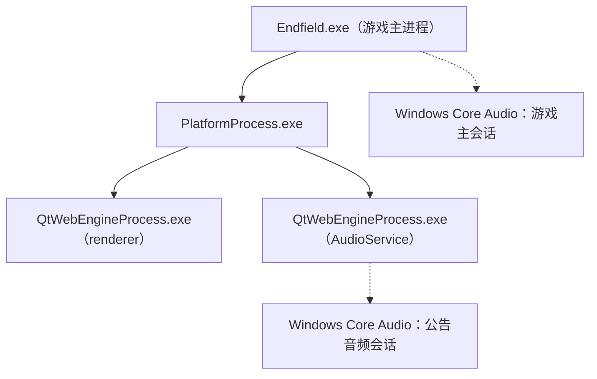
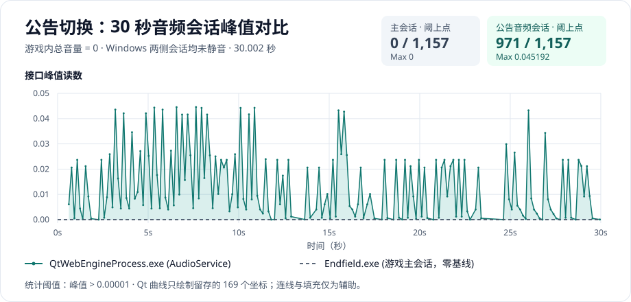

# Endfield Audio Link｜《明日方舟：终末地》PC 公告音效排查与音量联动

**QA 案例 EF-AUDIO-001 · Windows 11 · 2026 年 10 月 23 日**

在 Windows 中将《终末地》静音后，切换公告仍能听到音效。在游戏内将总音量调到 0，也观察到同一现象。正式采样采用后一种条件：游戏内总音量为 0，Windows 中两个相关会话均未静音。

**定位结果：本次公告切换声来自游戏启动的 Qt 网页音频服务。** 30 秒内，游戏主会话没有测到信号；只将网页音频服务的会话静音，再次切换公告，切换声消失。

[详细采样与验证记录](docs/evidence.md) · [结构化数据（JSON）](docs/evidence-summary.json) · [工具安装与使用手册](docs/tool-usage.md)

## 缺陷摘要

| 项目 | 记录 |
| --- | --- |
| 问题简述 | 游戏内总音量设为 0 后，切换公告仍有交互音效。 |
| 测试环境 | PC 客户端，Windows 11 Pro（Build 26300），耳机输出。未记录客户端业务版本。 |
| 复现步骤 | ① 保持 Windows 侧两个相关会话均未静音。② 将游戏内总音量设为 0。③ 打开公告并切换内容。 |
| 预期结果 | 公告切换声随游戏内总音量静音。 |
| 实际结果 | 仍能听到切换声；采样期间只有公告音频会话测到信号。 |
| 影响范围 | 公告交互音效的静音控制不一致，影响需要安静运行的场景。已在一台电脑验证；未分入口统计复现率。 |
| 定位线索 | Windows Core Audio 会话 PID 与 Qt AudioService 匹配；仅静音该会话即可消除切换声。 |
| 当前状态 | 已定位到 Windows 会话层，已有外部联动工具；客户端修复状态未验证。 |

## 两个同名进程，哪个在发声？

Windows 声音设置中没有单独显示公告音效的控制项。排查从一个假设入手：如果公告通过独立会话播放，那么切换时，即使游戏主会话没有信号，另一个会话也应出现峰值。



实线是父子进程关系，虚线表示本次通过 PID 匹配确认的会话归属。两个 Qt 子进程的文件名相同；**启动参数区分角色，会话 PID 确认由谁持有会话**。会话匹配缩小了范围，接下来用单独静音确认听到的切换声是否经过它。

## 两步对照：先测信号，再听结果

| 操作 | 游戏主会话 | 公告音频会话 | 现场听感 |
| --- | --- | --- | --- |
| 游戏内总音量为 0，切换公告并采样 30 秒 | 20%，未静音；超阈值 **0 / 1,157** 点 | 100%，未静音；超阈值 **971 / 1,157** 点 | 仍有切换声 |
| 保持游戏设置不动，只静音公告音频会话，再次切换 | 不改动 | 音量仍为 100%，静音开关已打开 | **切换声消失** |



阈值为 0.00001。图中 Qt 曲线使用原始采样文件实际留存的 169 个时间—峰值坐标；971 是完整窗口的阈上点计数，不是切换次数。峰值显示当时哪个会话存在信号，单独静音后的听感对照确认了声音归属。

## 黑盒推测与客户端改进建议

**已验证的是播放路径：** 公告切换声经过 Qt AudioService 的独立 Windows 音频会话。本轮测试中，游戏内总音量设为 0，并未让该会话停止输出切换声。

**建议优先检查总音量状态是否传到了内嵌 WebView。** 基于黑盒进程和会话现象，公告音频可能没有纳入主游戏的总音量控制。客户端可以在 WebView 初始化、会话重建和总音量变化时同步音量／静音状态，或让公告交互音效走受游戏总音量控制的音频路径。具体断点仍需研发侧核对代码和日志。

## 外部联动：用 Windows 游戏音量统一控制公告声

[`audio_link.py`](audio_link.py) 通过 Windows Core Audio 将游戏主会话的音量和静音状态单向同步到同一游戏实例的公告音频会话。正常退出时尝试恢复公告会话接管前的状态。**工具跟随的是 Windows 音量混合器，不是游戏内总音量滑块。**

当次 **28 项单元测试全部通过**，覆盖身份筛选、会话选择、同步和恢复。在真实游戏会话上另验证了 **6 次状态同步和 1 次计时退出恢复**，包括“0% 但未静音”和“15% 且静音”。

在仓库根目录打开 PowerShell，先按[工具安装与使用手册](docs/tool-usage.md#首次安装)创建 `.venv`，再运行：

```powershell
& .\.venv\Scripts\python.exe -m pip install -r requirements.txt
& .\.venv\Scripts\python.exe -m unittest discover -s tests -v
& .\.venv\Scripts\python.exe audio_link.py --status
```

`--status` 只读查看当前匹配到的会话，不改变音量。持续联动、退出恢复和显式实机验收命令见[工具安装与使用手册](docs/tool-usage.md)。

## 项目分工与范围

**我负责**发现异常，提出对照后台进程与音频会话，设计采样和单独静音对照，确定零音量与静音分开测试等边界用例，并在现场操作公告、确认听感。**AI 协助**读取系统会话、实现采样与联动脚本、编写测试驱动并执行自动化检查。

排查仅通过公开客户端的正常操作和 Windows 公开接口（Core Audio、进程只读查询）进行，不涉及逆向、解包、游戏内存读写、注入或修改游戏文件。本仓库用于个人 QA 方法与测试工程展示，相关游戏及商标权利归各自权利人所有。仓库代码采用 [MIT 许可证](LICENSE)。

<details>
<summary>本案用语</summary>

- **公告切换声**：在 PC 版公告界面切换内容时听到的交互音效。
- **游戏内总音量**：游戏设置中的总音量滑块，与 Windows 混合器中的游戏音量分别设置。
- **游戏主会话**：Windows 中归属于游戏主进程的音频会话。“音量 0%”和“已静音”是两个独立状态。
- **公告音频会话**：本次测试中承载公告切换声的 Windows 音频会话，归属于游戏启动的网页音频服务。此名称不意味着它只播放公告音效。

</details>
