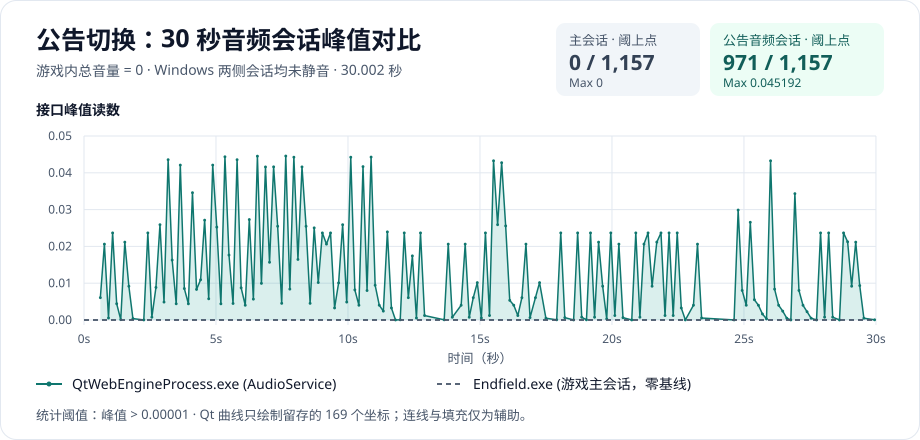

# EF-AUDIO-001｜采样与验证记录

[← 返回案例首页](../README.md) · [工具安装与使用手册](tool-usage.md) · [结构化结果（JSON）](evidence-summary.json)

这份记录回答两个问题：**公告切换声来自哪个会话？外部工具能否控制这个会话并恢复原值？** 前者用峰值采样和单独静音的听感对照验证；后者用单元测试和真实会话状态回读验证。文中时间均为 UTC+8。

## 一、原始问题：复现与定位

| 测试条件 | 当次记录 |
| --- | --- |
| 环境 | PC 客户端，Windows 11 Pro（Build 26300），耳机输出。未记录客户端业务版本；可执行文件版本元数据不能替代客户端版本。 |
| 操作 | 打开公告并切换内容。界面有顶部分类和左侧条目，当次未分别统计各入口。 |
| 预期 | 游戏内总音量为 0 时，切换公告不应发声。 |
| 首次观察 | 10 月 23 日 21:24，分别在 Windows 中给游戏静音、在游戏内将总音量设为 0，均听到切换声。留存的截图只用于确认公告入口。 |
| 正式采样条件 | 仅将**游戏内总音量**设为 0。Windows 游戏主会话音量为 20%，公告音频会话为 100%，均未静音，输出到同一副耳机。 |

**会话归属。** 两个同名 Qt 子进程均由游戏的 `PlatformProcess.exe` 启动，三个层级的程序均来自同一安装目录。一个子进程带 `--type=renderer`，另一个带 `--type=utility` 和 `--utility-sub-type=audio.mojom.AudioService`。后者与 Windows Core Audio 返回的会话 PID 一致。

**峰值采样。** 10 月 23 日 21:32:28–21:32:58，在公告界面切换内容，同期连续读取两条会话的峰值，窗口长 **30.002 秒**。读数严格大于 **0.00001** 记作一个阈上点。采样不录制声音内容。

| 会话 | 总采样点 | 阈上点 | 最大峰值（接口读数） |
| --- | ---: | ---: | ---: |
| 游戏主会话 | 1,157 | 0 | 0 |
| 公告音频会话 | 1,157 | 971 | 0.045192 |

阈上点和最大峰值来自完整窗口的统计；图中留存坐标的最高值为 0.044556，因此折线的最高点与摘要中的最大峰值不同。原始文件的 `signal_times` 仅留存公告音频会话的 169 个时间—峰值坐标；图逐点绘制留存坐标，连线和填充仅为阅读辅助，未补造其余采样点。主会话的最大峰值为 0，以零基线表示。一次切换可能对应多个阈上点；峰值不等于分贝、听感响度或声音持续比例。

**单独静音。** 21:34，只打开公告音频会话的静音开关。系统回读从“100%，未静音”变为“100%，已静音”。保持游戏内总音量和 Windows 游戏主会话设置不动，再次切换公告，确认切换声消失。

本次定位覆盖一台机器、一轮采样和一次静音听感对照。Windows 侧单独静音游戏的现象属于初始观察，尚未按独立条件重测；也未留存带声音的完整对照录像。

## 二、外部联动工具：识别、同步与恢复

后续需求是**只在 Windows 音量混合器里调整《终末地》**。工具使用 Python、pycaw 和 psutil，以游戏主会话为源、同一游戏实例的公告音频会话为目标，只向目标写入。

| 设计问题 | 实现选择 |
| --- | --- |
| 怎样避免动到别的软件？ | 校验游戏 → 平台 → 音频服务的父子关系、安装目录、角色参数和进程创建时间。渲染进程和其他软件的同名 Qt 进程不接管。 |
| 一个游戏实例有多个会话怎么办？ | 优先同一输出设备上的源；多个候选中仅一个活跃时选它，仍有歧义就等待。游戏或公告稍后启动时，重新扫描会话。 |
| 音量和静音怎样联动？ | 分别读取音量和静音，状态一致就不写。需要静音时先静音再调音量；需要发声时先调到目标音量，再解除静音。 |
| 如何退出而不覆盖手动设置？ | 首次写入前保存目标原值。恢复时核对设备、会话实例和进程创建时间；若发现目标已被单独改动，则保留手动设置。 |

除持续联动外，工具还支持只读查看、单次同步和按记录恢复。持续模式默认每 0.25 秒检查已发现会话，每 2 秒扫描会话；实机验收使用了更短的间隔。

### 28 项单元测试：重点是何时不该动音量

| 测试组 | 数量 | 覆盖场景 |
| --- | ---: | --- |
| 进程身份 | 6 | 正确进程链、异目录同名进程、排除渲染进程、父 PID 复用、指定游戏路径不符、平台父进程缺失。 |
| 会话选择 | 5 | 同设备优先、唯一跨设备源、多个候选仅一个活跃、多个候选无法区分、其他游戏实例隔离。 |
| 同步、恢复与输入 | 17 | 音量和静音独立、无变化不写、无源等待、新会话加入、源不被反写；首次写入前落盘、多轮同步和重新加载后恢复、部分写入失败、拒绝向重建会话或身份不符的进程恢复、保护手动修改、重新接管；损坏记录和非法输入。 |

关键回归用例：停用工具后手动调了公告音量。再次启动、同步并退出时，应恢复到**最后一次手动设置的值**，而不是第一次接管前的旧值。2026 年 10 月 23 日的测试结果为 **28/28 通过**，使用的是模拟进程与会话。

### 7 项真实会话检查：6 次跟随，1 次恢复

22:02，游戏和 Qt 音频服务进程都在运行，但系统只枚举到游戏主会话。我打开公告并切换内容以创建会话，保持页面打开。22:04，确认两个会话都可读取后才开始验收。进程存在，不等于对应会话已经可测。

测试驱动短暂调整 Windows 游戏主会话，回读公告会话状态。联动轮询为 0.1 秒，会话扫描间隔为 1 秒。耗时从驱动设置源状态后开始计，到首次读到目标匹配为止。

| 检查 | 公告音频会话实际状态 | 观测耗时 |
| --- | --- | ---: |
| 设为 0%，保持未静音 | 0%，未静音 | 0.101 秒 |
| 升至 15% | 约 15%，未静音 | 0.102 秒 |
| 15% 时静音 | 约 15%，已静音 | 0.102 秒 |
| 15% 时解除静音 | 约 15%，未静音 | 0.050 秒 |
| 升至 20% | 约 20%，未静音 | 0.101 秒 |
| 20% 时静音 | 约 20%，已静音 | 0.153 秒 |
| 联动程序计时退出 | 恢复到接管前的 **100%，已静音** | 退出后回读通过 |

六次同步中，源会话维持测试驱动设定的状态。第七项在驱动兜底清理前通过，由联动程序自行恢复目标，退出码为 0。测试结束后，驱动将源恢复为约 20%、未静音。

本轮联动子进程启动至检测到会话约 5.285 秒，与表中的状态同步耗时分开。六次耗时不代表默认参数下的延迟、最大延迟或音频播放延迟。实机跟随最高测试到 20%；100% 只作为已静音的恢复值验证，没有做大音量试播。逐档验收以系统回读为准；听感确认针对第一节的单独静音对照。

JSON 中的实机音量使用 0–1 标度；`0.20000000298023224`、`0.15000000596046448` 等是 Windows Core Audio 32 位浮点接口的原始回读值，未做人工改写。

**次日恢复使用。** 10 月 24 日 00:38，按需解除公告会话静音。此时进程号已变，按进程角色重新匹配目标，系统回读从“100%，已静音”变为“100%，未静音”。该操作与前一晚的持续联动验收分开记录。

## 三、未验证场景与后续回归建议

**游戏侧。** 优先记录客户端精确版本，将顶部分类、左侧条目分别复现并记录尝试次数；补做“游戏内音量正常，仅静音 Windows 游戏主会话”的对照并留存带声记录。未验证其他客户端版本、其他设备上的复现情况，也未确认全部公告交互或小游戏是否共用同一会话。

**工具侧。** 优先验证会话重建、设备变化和异常退出：旧记录不能写入新会话，条件不明确时应等待或跳过。

| 尚未完成的真实场景 | 当前证据或预期检查 |
| --- | --- |
| 关闭并重开公告、先启动工具再开游戏、重启游戏 | 逻辑覆盖；实机检查重新发现后是否只接管新且可核实的会话。 |
| 耳机／扬声器切换、设备拔插 | 未实测；检查是否正确发现新设备及会话。 |
| 多游戏实例、多候选会话、其他 Qt 软件同时运行 | 有路由及身份筛选测试，未做实机隔离对照。 |
| 按 Ctrl+C 退出 | 与计时退出使用相同的恢复路径，但未做实机键盘操作。 |
| 强制结束后执行 `--restore` | 已有恢复逻辑测试；实机强制中止与恢复待验。 |
| Windows 重启 | 未实测；工具不安装自启动。 |
| 长时间运行 | 仅做短时验收，未测长期资源占用或同步延迟分布。 |

## 证据索引

公开结果为本页、SVG 图和 [JSON 汇总](evidence-summary.json)。原始数据保留在本机忽略目录，不随仓库分发：

| 本机记录 | 对应证据 |
| --- | --- |
| `.runtime/evidence/capture-20261023-213258.json` | 会话峰值、阈上点汇总及留存坐标。 |
| `.runtime/evidence/mute-state-20261023-213408.json`、`.runtime/manual-unmute-20261024-003850.json` | 静音操作前的会话状态及次日解除静音记录；切换声消失由现场听感确认。 |
| `.runtime/evidence/environment.json`、公告截图 | 系统环境元数据和操作入口；截图不作为声音证据。 |
| `.runtime/unit-tests.log`、`.runtime/live-acceptance.json`、`.runtime/live-monitor-output.log` | 单元测试结果、实机七项回读及联动程序日志。 |

**分工。** 我负责异常发现、对照设计、游戏内条件与公告操作、边界用例和现场听感确认。AI 协助采集与分析系统会话、实现联动工具及测试驱动。
